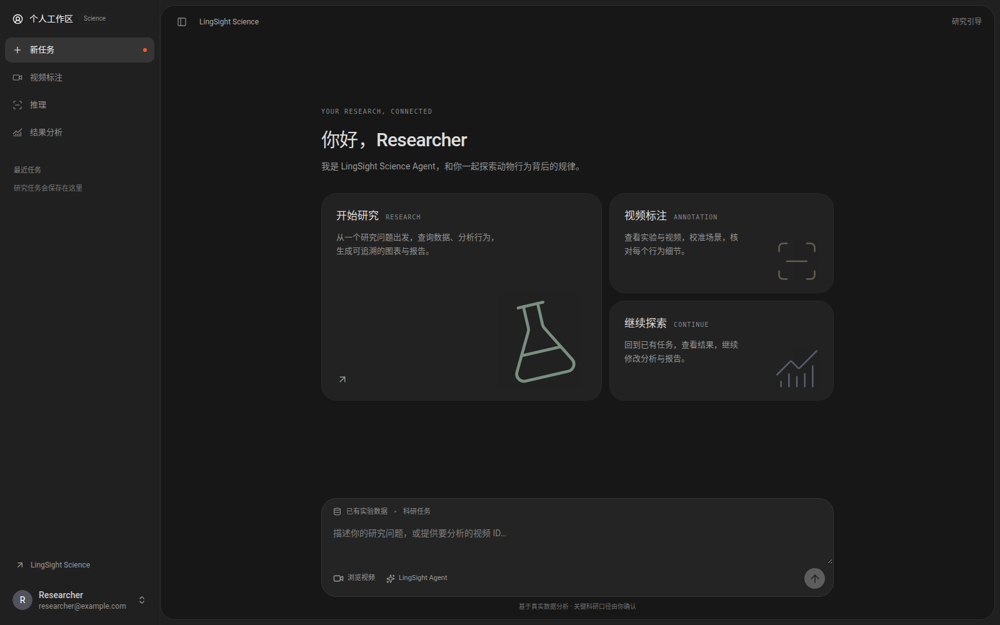
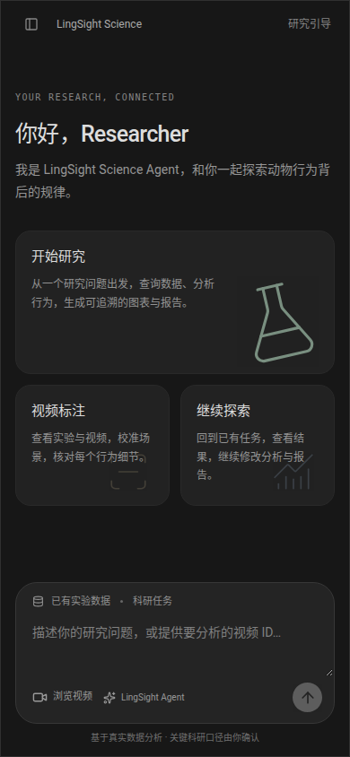

# 科研任务工作区首轮接入验收

日期：2026-11-09（本机联调，未发布）。

## 目标、接口与边界

复用另一份已完成的引导，在进入科研对话前展示；最终输入为研究问题、可选数据范围和引导附带的科研约定。引导仅保存说明，进入工作区后由用户发送才创建任务。根路由为对话，新任务获得 `/tasks/:taskId` 稳定地址。侧栏提供视频标注、推理和结果分析，旧试次目录迁至 `/annotations`，试次固定地址与旧 `/qa` 保留。

React 经登录后的 FastAPI `/api/v1/agent/*` 访问独立服务的 `/v1/*`。任务、执行、事件及文件属于 Agent；平台仅做鉴权和允许操作的转发，不复制任务存储。前端采用事件游标轮询（1.5 秒）与任务快照刷新，切换页面仅取消浏览器请求，刷新从事件记录重建对话。网关同时可转发 SSE，但当前 UI 不使用 SSE。

输入失败保留草稿；服务未配置、断连、账号未开通均有明确提示；关键口径通过澄清接口答复，失败/中断提供显式恢复；文件按登录权限下载，报告作为纯文本安全预览并另存新版本。超长文本只预览前 512 KB，并提示下载完整文件。

服务端 token 不进入浏览器。鉴于独立 Agent 当前没有任务 owner，本轮只允许管理员和 `AGENT_WORKSPACE_EMAIL` 指定的单个普通账号；没有实现多租户隔离。视频 GPU 推理仍显示待接入。

## 修改范围

- 前端 `src/features/agent/`：对话、执行状态、澄清、交付物、结果列表、服务状态和深色布局。
- `src/features/research/entry.ts`、引导结束动作和首页路由：已看标记、研究说明接力；保留已有引导设计。
- 侧栏、布局、认证缓存及 trial 返回入口：新的导航结构与账号切换清缓存。
- 后端 `app/api/routes/agent.py`、API router、Settings，以及 `.env.example`、Compose：认证代理与服务配置。
- 网关 unittest、工作区 Playwright，以及原目录/QA 的导航断言。

## 验证

1. `docker exec lingsight-ui-gateway python -m unittest tests.api.routes.test_agent_gateway`：9 项通过，覆盖认证、个人账号边界、私有令牌、事件游标、路径白名单、上游错误、二进制下载与请求大小。使用独立 FastAPI + MockTransport，不加载 pytest 数据库夹具、不清库。见 `gateway-tests.log`。
2. `docker exec lingsight-ui-gateway bash scripts/lint.sh`：mypy、ty、ruff 和格式检查全部通过，见 `backend-static.log`。新增 unittest 文件另经 ruff 检查及格式化。
3. `cd frontend && bun run build`：TypeScript 与 Vite 构建通过，见 `frontend-build.log`。本轮修改的工作区、路由、导航和测试均通过定向 Biome。
4. `bun x playwright test tests/agent-workspace.spec.ts tests/onboarding.spec.ts --project=chromium --no-deps --workers=2 --reporter=line`：14 项通过，见 `playwright-workspace.log`。使用接口夹具，覆盖首次引导 → 输入接力但不自动发送、任务创建与刷新重放、澄清提交、失败保留输入、安全报告预览、报告保存失败重试和移动端布局。
5. `bun x playwright test tests/trial-directory.spec.ts tests/qa-page.spec.ts --project=chromium --no-deps --workers=2 --reporter=line`：11 项通过，见 `playwright-regression.log`。目录与科研问答的业务请求均使用夹具，不执行真实研究查询。
6. `docker compose --env-file .env.example config --quiet`：通过，仅验证 Compose 配置结构。

## 真实连接验证

使用平台已有普通账号登录，在真实浏览器通过 Vite → FastAPI 网关 → Agent 创建最小联调任务。指令要求先询问视频 ID，在答复前不要查询数据库、运行 Python 或生成报告。服务进入 `waiting_for_input` 并返回一个澄清问题；刷新页面后可继续读取；浏览器点击停止后核实状态为 `cancelled`，无页面脚本错误。记录见 `live-connection.log`。

本轮真实验证覆盖登录与任务控制链路。报告预览、编辑失败重试等使用契约夹具；没有重跑真实科研统计/完整报告闭环，不能据此宣称统计正确性或全平台迁移完成。

运行方式见 [前端 README](../../../frontend/README.md)。联调网关使用本仓库源码，独立于原 `:8000` 服务，未替换原容器或运行数据库迁移；Agent 服务源码未修改。

## 页面检查

截图使用非敏感固定用户及空任务列表，不含真实科研内容。桌面 1600 × 1000；窄屏 390 × 844，页面宽高未超出视口，输入区和侧栏开关可用。






## 左侧栏对齐官网设计 · 2026-11-10

按用户提供的官网工作台参考图调整实际应用左侧栏。顶部使用 ScanLine 图标、LingSight Lab 品牌、SCIENCE 标识与可操作的工作区菜单；菜单采用中性深灰底色、较宽行间距和统一线性图标。最近任务支持折叠，每行显示实际任务名称及最新执行状态，当前任务用灰色背景突出。搜索入口在已有任务列表内按名称筛选，不发起科研分析，也不创建示例任务。原有用户管理权限、账号菜单与移动抽屉导航沿用既有行为。

修改：`frontend/src/components/Sidebar/AppSidebar.tsx`、`Main.tsx`、新增 `research-sidebar.css`、`frontend/src/features/agent/workspace.css` 的侧栏颜色、`frontend/tests/agent-workspace.spec.ts` 与说明文档。参考图中的项目分组尚无对应任务模型，本次没有填充虚构项目。

在 `frontend/` 验证：

```bash
PLAYWRIGHT_BASE_URL=http://127.0.0.1:5173 bun x playwright test tests/agent-workspace.spec.ts --project=chromium --no-deps --reporter=line --workers=1 --output=/tmp/lingsight-sidebar-tests-nov10
# 10 passed (27.9s)，含原有任务/报告流程及新增侧栏交互，完整输出见下方日志。

bun x biome check src/components/Sidebar/AppSidebar.tsx src/components/Sidebar/Main.tsx src/components/Sidebar/research-sidebar.css tests/agent-workspace.spec.ts
# Checked 4 files. No fixes applied.

bun run build --outDir /tmp/lingsight-sidebar-build-nov10
# TypeScript + Vite exit 0; built in 959ms.
```

日志：[sidebar-playwright-2026-11-10.log](sidebar-playwright-2026-11-10.log)。通过空登录态与 API 夹具验证品牌菜单、真实状态显示、任务选中和分组折叠、完整任务列表搜索/无匹配/关闭恢复、折叠后搜索、移动端选择任务后收起抽屉，以及既有任务创建、澄清和交付物流程。未访问真实科研数据或运行 pytest。

已检查 1440×960 桌面截图与 390×844 移动抽屉，页面 JavaScript 错误为 0，无横向溢出。桌面截图 `/tmp/lingsight-sidebar-desktop-nov10-r1.png`、移动截图 `/tmp/lingsight-sidebar-mobile-nov10-r2.png` 使用非敏感固定用户和示例任务。构建输出到临时目录，本次验证不代表完整科研闭环联验或正式部署。


## 完整英文侧栏与首页 · 2026-11-10

用户要求完整复刻参考图的左侧栏并将首页改为英文。本轮补齐红黄绿窗口装饰、LingSight Lab / SCIENCE 品牌、五个英文入口、Recent tasks、Projects 与文件夹图标；任务列表仍读取真实 Agent 数据，不创建示例科研任务。实际工作台首页改为中央研究流程、右侧 Overview 与底部输入框，首页建议只填入输入框，由用户发送后启动任务。Overview 展示工作流程说明，未将未执行步骤标为完成。研究对话、状态、交付物操作、账号菜单、共享布局和登录页使用英文；用户输入、任务名称、分析结果、后端错误保留原文。官网主标题改为 “Decode animal behavior, frame by frame.”，HTML 默认语言与默认标题改为英文。既有研究引导及试次/推理工具详情页本轮不作完整翻译。

五个入口对应：New research task → `/`；Experiments & data → `/experiments`（复用现有受权限控制的实验/试次目录）；Videos & annotations → `/annotations`；Analysis & reports → `/analysis`；Search research → 已有任务标题筛选。原有 Video inference 入口保留在品牌菜单。管理入口仅向管理员展示。

Projects 是前端个人整理功能。默认提供两个空文件夹 Learning & memory 和 Behavior research notes，与参考图一致；支持新建文件夹、在项目页选择已有任务、取消归类与刷新恢复。只把项目名及任务 ID 保存在当前浏览器、按账号 ID 区分的 localStorage；任务和交付物仍由 Agent 服务拥有，不复制科研数据、不向任务 API 发起项目写入。创建弹窗及项目页明确说明当前浏览器保存范围，尚无跨设备项目同步。存储失败保留输入并报错，非法存储不覆盖原值且不阻止研究任务访问。

主要修改文件：

- `frontend/src/components/Sidebar/{AppSidebar,Main,User}.tsx` 与 `research-sidebar.css`：完整侧栏、入口、项目创建和英文文案。
- `frontend/src/features/agent/Workspace.tsx`、`workspace.css`、`Artifacts.tsx`、`api.ts`、`events.ts`：首页布局、流程建议、英文状态与交互。
- 新增 `frontend/src/features/agent/projects.ts`、`ProjectPage.tsx` 与项目路由；新增实验目录入口路由，`routeTree.gen.ts` 由 Vite 路由插件生成。
- 共享布局、首页/分析/任务路由标题、登录页、AuthLayout、Footer、Logo、`frontend/index.html`，以及官网 `LingSightLanding.tsx` 主标题。
- `agent-workspace.spec.ts`、`landing-navigation.spec.ts`、既有 QA 测试的侧栏名称断言与前端 README。

在 `frontend/` 执行：

```bash
PLAYWRIGHT_BASE_URL=http://127.0.0.1:5173 bun x playwright test tests/agent-workspace.spec.ts tests/landing-navigation.spec.ts --project=chromium --no-deps --reporter=line --workers=1 --output=/tmp/lingsight-english-workspace-tests
# 17 passed (26.1s)

# 手机排版与 HTML 语言标记收尾后，复验相关用例：
PLAYWRIGHT_BASE_URL=http://127.0.0.1:5173 bun x playwright test tests/agent-workspace.spec.ts tests/landing-navigation.spec.ts --grep '窄屏输入框|折叠侧栏|public homepage' --project=chromium --no-deps --reporter=line --workers=1 --output=/tmp/lingsight-english-mobile-tests
# 3 passed (6.0s)

bun run build --outDir /tmp/lingsight-english-workspace-build
# TypeScript + Vite exit 0; built in 1.67s.
```

定向 Biome 检查覆盖 24 个本轮修改的 TS/TSX/CSS 文件（含侧栏、工作区、项目、路由、共享认证组件与测试），结果为 `Checked 24 files. No fixes applied.`。测试完整输出见 [英文工作区日志](english-workspace-playwright-2026-11-10.log) 和 [手机复验日志](english-mobile-playwright-2026-11-10.log)。覆盖既有任务创建、刷新重放、澄清、报告安全预览与保存失败重试，同时验证英文首页无中文静态文案、菜单路由、建议不自动提交、项目创建/归类/移除/刷新、账号隔离与损坏存储、存储失败保留输入，以及官网滚动刷新行为。

浏览器实际查看 1600×1000 桌面、390×844 手机首页及抽屉，以及英文官网首屏；无页面 JavaScript 错误、无横向溢出。截图采用固定演示用户及任务夹具：`/tmp/lingsight-english-home-desktop-r2.png`、`/tmp/lingsight-english-home-mobile-r2.png`、`/tmp/lingsight-english-sidebar-mobile-r2.png`、`/tmp/lingsight-english-public-home-r2.png`，每次新文件名。未执行真实科研任务、后端测试或数据库迁移，构建仅输出临时目录。
